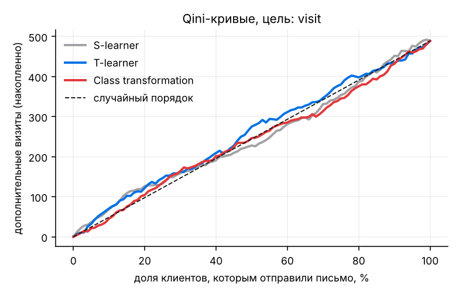
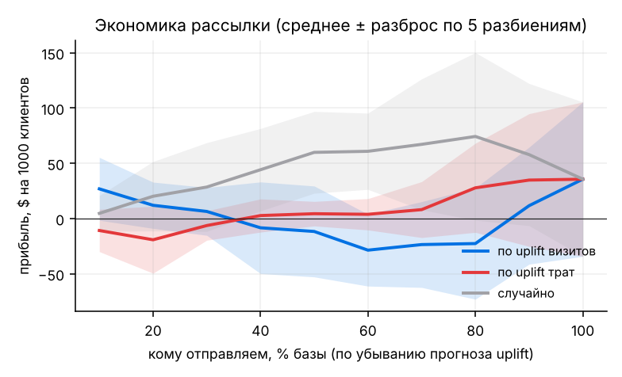

# Uplift-моделирование: кому отправлять предложение

Анализ реального рандомизированного эксперимента на 64 000 клиентах: кому рассылка действительно меняет поведение, можно ли на этом заработать и когда персонализация не нужна.

Задача та же, что у банков с кешбэк-офферами и push-кампаниями: контакт стоит денег, часть клиентов купит и без него, а часть не купит в любом случае. Платить имеет смысл только за тех, на кого предложение влияет.

<p align="center"></p>

## Данные

[Kevin Hillstrom, MineThatData E-Mail Analytics Challenge](https://blog.minethatdata.com/2008/03/minethatdata-e-mail-analytics-and-data.html), открытый датасет. 64 000 покупателей интернет-магазина случайно разделили на три группы: письмо с мужской коллекцией, письмо с женской и без письма. Через две недели измерены визит на сайт, покупка и сумма покупки. Файл лежит в `data/` (430 КБ), поэтому интернет для запуска не нужен.

## Что получилось

**1. Эксперимент корректный.** Группы по 21,3 тыс. человек (SRM-тест, p = 0,90), признаки сбалансированы (максимальная стандартизированная разница 0,014 при пороге 0,1).

**2. Мужское письмо работает лучше женского.**

| Мужское письмо против «без письма» | Эффект | 95% ДИ |
|---|---:|---|
| Визит на сайт | +7,7 п.п. (+72%) | [7,0; 8,3] |
| Покупка | +0,68 п.п. (+119%) | [0,50; 0,86] |
| Траты на клиента | +$0,77 | [0,49; 1,05] |

Женское письмо даёт примерно вдвое меньше: +4,5 п.п. визитов, +$0,42 трат.

**3. Сильнее всего письмо действует на тех, кто раньше покупал и мужское, и женское:** +13,4 п.п. визитов против ~7 п.п. у остальных. В остальных срезах (новые клиенты, канал, сумма покупок) эффект почти одинаковый. Полная таблица в [`reports/heterogeneity.csv`](reports/heterogeneity.csv).

**4. Модели находят тех, кто чаще придёт на сайт, но эффект однородный.** Сравнил S-learner, T-learner и трансформацию классов на 5 случайных разбиениях 70/30:

| Цель: визит | Uplift в топ-10% | Uplift в топ-30% |
|---|---:|---:|
| T-learner | **11,8 п.п.** ± 1,5 | 8,7 п.п. ± 0,4 |
| S-learner | 10,9 п.п. ± 0,9 | 8,9 п.п. ± 0,4 |
| Class transformation | 8,4 п.п. ± 2,6 | 8,6 п.п. ± 1,0 |
| Средний эффект по всем | 7,7 п.п. | 7,7 п.п. |

Если отправить письмо только 10% базы, отобранным T-learner'ом, получим 15% всех дополнительных визитов (в 1,5 раза лучше случайного выбора). Для топ-30% это 34%, то есть почти так же, как случайно. Сильных «спящих» сегментов в данных нет.

**5. По покупкам и деньгам модели не лучше случайного выбора.** Покупает около 1% клиентов, и сигнала для обучения слишком мало: Qini для покупки около нуля на всех моделях. Ранжирование по прогнозу визитов в деньги не переносится, и модель, обученная прямо на тратах, тоже не обгоняет случайный порядок ([график](reports/figures/profit.png)). Разброс между разбиениями больше самого эффекта.



**6. Персональная политика «каждому своё письмо» не обыгрывает простое правило.** Ценность политики оценена без нового эксперимента, через IPW: группы назначены случайно с вероятностью 1/3, поэтому оценка несмещённая.

| Политика (среднее по 5 разбиениям) | Визитов на 1000 | Прибыль, $ на 1000 | Кому пишем |
|---|---:|---:|---:|
| Никому | 105 | 196 ± 18 | 0% |
| Всем мужское | **182** | **237 ± 63** | 100% |
| Всем женское | 153 | 159 ± 59 | 100% |
| Случайное письмо или ничего | 147 | 210 ± 67 | 67% |
| Модель: лучшее письмо каждому | 154 | 179 ± 59 | 62% |

При меньшем охвате (62% против 67%) модель даёт больше визитов, чем случайный выбор, но по деньгам выигрыша нет.

## Вывод для бизнеса

- **Решение сейчас:** отправить мужское письмо всем. При марже 30% и стоимости контакта $0,15 это около **+$81 на 1000 клиентов**, но 95% ДИ [−5; +166] задевает ноль. Если контакт дороже ~$0,23, рассылка в среднем перестаёт окупаться.
- **Сложную персонализацию пока не строить:** на этом объёме данных она не окупается.
- **Если цель — деньги, нужен тест больше.** Чтобы вдвое сузить интервал по тратам, выборку надо увеличить в 4 раза (~85 тыс. клиентов на группу). Или оптимизировать более частую метрику с проверкой, что она переносится в выручку.
- **Отдельно проверить сегмент «покупал оба типа товаров»:** там эффект вдвое выше. Хороший кандидат для отдельной кампании.

## Методы

- Проверка эксперимента: SRM (χ²), стандартизированные разницы средних.
- Средние эффекты с доверительными интервалами, неоднородность по срезам.
- Uplift-модели ([`src/models.py`](src/models.py)): S-learner, T-learner, трансформация классов (Jaskowski & Jaroszewicz, 2012), T-learner на регрессии для трат. Базовая модель — градиентный бустинг.
- Метрики ([`src/uplift_metrics.py`](src/uplift_metrics.py)): Qini-кривая и площадь под ней, uplift@k, доля захваченного эффекта. Покрыты тестами на данных с известным ответом.
- Офлайн-оценка политики через inverse propensity weighting.

## Как запустить

Нужен Python 3.10 или новее.

**macOS / Linux**
```bash
git clone https://github.com/antonshkelll/uplift-targeting.git
cd uplift-targeting
python3 -m venv .venv
source .venv/bin/activate
pip install -r requirements.txt
python src/run.py          # ~1 минута; графики в reports/figures, цифры в reports/results.json
pytest -q                  # тесты метрик
```

**Windows (PowerShell)**
```powershell
git clone https://github.com/antonshkelll/uplift-targeting.git
cd uplift-targeting
py -m venv .venv
.venv\Scripts\Activate.ps1
pip install -r requirements.txt
python src/run.py
```

Если PowerShell не даёт активировать окружение, один раз выполните `Set-ExecutionPolicy -Scope CurrentUser RemoteSigned`.

Допущения по экономике (маржа и стоимость контакта) заданы в начале [`src/run.py`](src/run.py).

## Ограничения

- Магазин не банковский, и эксперимент 2008 года. Методика переносится один к одному, а цифры нет.
- Маржа и стоимость контакта взяты как допущения. На реальной задаче их нужно взять у бизнеса.
- Горизонт эффекта две недели: долгосрочное влияние рассылок (отписки, привыкание) здесь не видно.

## Структура

```
data/hillstrom.csv.gz     исходные данные
src/data.py               загрузка и подготовка признаков
src/models.py             S-learner, T-learner, class transformation
src/uplift_metrics.py     Qini, uplift@k
src/run.py                весь анализ
tests/                    тесты метрик и моделей
reports/                  графики, results.json, heterogeneity.csv
```
